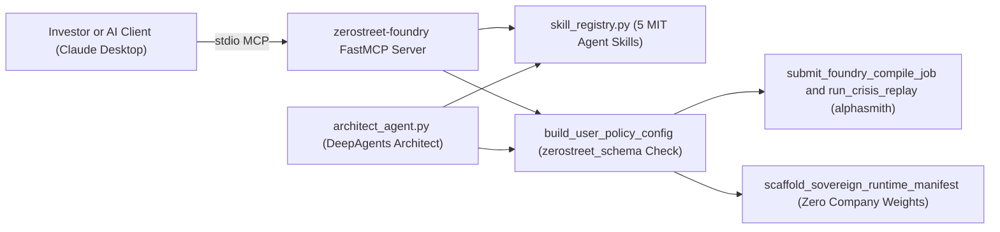

<div align="center">

[](./README.md)
[](./README.en.md)

[🇰🇷 한국어](./README.md) · [🇺🇸 English](./README.en.md)

</div>

# zerostreet-skills (`v0.1.0`) — Build-Time Agent Skills & Foundry MCP (Layer 0.5 Public MIT)

> **Design, stress-test, and scaffold your local trading daemon from natural language without misconfiguring risk invariants.**

---

## Why `zerostreet-skills`?

1. **Guides Coding Assistants With Audited Domain Rules**: Ships 5 Progressive-Disclosure MIT Agent Skills (`skills/*/SKILL.md`) covering rebalance math, pre-trade risk gates, portfolio risk audits, macro crisis simulation, and sovereign runtime architecture.
2. **Schema-Validated Foundry MCP Tooling**: Exposes 6 structured tools over `FastMCP` (`fastmcp>=4.0`) so assistants validate `UserPolicyConfig`, invoke `alphasmith` Foundry compilation and crisis replay, and emit local runtime manifests (`contains_company_weights=False`).

---

## Build-Time Architect & Foundry MCP Flow



### Package & Skills

- **Agent Skills (`skills/`)**: `sovereign-system-architect`, `rebalance-math-solver`, `pre-trade-risk-gate`, `portfolio-risk-audit`, `macro-crisis-sim`
- **Python Modules (`src/zerostreet_skills/`)**:
  - [`foundry_mcp.py`](./src/zerostreet_skills/foundry_mcp.py): `FastMCP` (`fastmcp>=4.0`) server exposing 6 MCP tools, `AlphaSmithFoundryClient`, and `zerostreet-foundry-mcp` entrypoint
  - [`skill_registry.py`](./src/zerostreet_skills/skill_registry.py): `discover_skills`, `load_skill_markdown`, `validate_skills_compliance`
  - [`architect_agent.py`](./src/zerostreet_skills/architect_agent.py): `create_zerostreet_architect_agent`
- **Client Config Example**: [`claude_desktop_config.example.json`](./claude_desktop_config.example.json)

---

## Verification & Launch

```bash
uv sync --extra dev
uv run ruff check .
uv run pytest -q
uv run zerostreet-foundry-mcp
```

- Repository Wiki (Korean-primary): [./openwiki/quickstart.md](./openwiki/quickstart.md)
