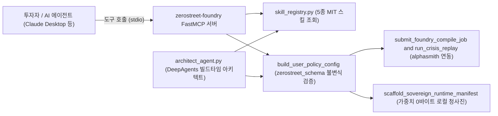

<div align="center">

[](./README.md)
[](./README.en.md)

[🇰🇷 한국어](./README.md) · [🇺🇸 English](./README.en.md)

</div>

# zerostreet-skills (`v0.1.0`) — 자연어로 내 투자 시스템을 설계·검증하는 에이전트 스킬 & MCP (Layer 0.5 Public MIT)

> **복잡한 설정 파일(YAML)이나 수식을 외우지 않아도 됩니다.**  
> `zerostreet-skills`는 내 투자 성향을 말로 설명하면 스키마 불변식을 먼저 검증해 주고(`UserPolicyConfig`), 과거 폭락장 테스트(`/v1/eval/crisis`)와 로컬 실행 환경 청사진(`contains_company_weights=False`)까지 한 번에 만들어 주는 MCP 서버·스킬 모음입니다.

---

## 왜 `zerostreet-skills`가 필요한가요?

코딩 에이전트(Claude Desktop 등)를 써서 자동 투자 환경을 꾸릴 때 소비자가 자주 겪는 문제는 두 가지입니다.

1. **AI 코딩 도우미가 내 계좌 조건에 맞지 않는 엉뚱한 설정이나 허술한 안전장치를 짜 줄 수 있습니다.**  
   `zerostreet-skills`는 5종의 표준화된 전문 스킬(`skills/*/SKILL.md`)을 단계별(Progressive Disclosure)로 제공해, 에이전트가 반드시 **리밸런싱 수학 정합성**, **사전 리스크 게이트**, **거시 위기 시뮬레이션** 원칙을 따르도록 안내합니다.
2. **클라우드 파운드리 컴파일 요청이나 로컬 데몬 환경 구성을 매번 수작업으로 맞추기 번거롭습니다.**  
   **FastMCP**(`fastmcp>=4.0`) 기반의 `zerostreet-foundry` 서버가 `build_user_policy_config`, `submit_foundry_compile_job`, `run_crisis_replay`, `scaffold_sovereign_runtime_manifest` 6가지 도구를 제공하므로, 에이전트가 실수 없이 로컬 데몬 설정(`AlphaGraph` + `Guardrail`)을 조립해 줍니다. 이때 회사의 독점 가중치가 섞여 있지 않음(`contains_company_weights=False`)을 명시적으로 보장합니다.

---

## 빌드타임 아키텍트 및 Foundry MCP 흐름



### 포함된 5종 MIT 에이전트 스킬 (`skills/`)

| 스킬 이름 | 역할 설명 |
| :--- | :--- |
| `sovereign-system-architect` | 내 PC 중심 로컬 매매 환경(`AlphaGraph` + `Guardrail` + `Broker MCP`) 전체 설계 가이드 |
| `rebalance-math-solver` | 목표 비중과 현재 비중 차이에서 매매 수량·최소 주문 금액·현금 제약을 계산하는 규칙 |
| `pre-trade-risk-gate` | 주문 직전 단일 종목 비중 한도·증거금·킬스위치 차단 조건 검증 규칙 |
| `portfolio-risk-audit` | 포트폴리오 집중도·상관관계·낙폭 노출 점검 체크리스트 |
| `macro-crisis-sim` | 과거 위기 국면 리플레이 및 손실 내성 점검 워크플로우 |

### 주요 파이썬 모듈 (`src/zerostreet_skills/`)

- [`foundry_mcp.py`](./src/zerostreet_skills/foundry_mcp.py): `FastMCP`(`fastmcp>=4.0`) 기반 6종 MCP 도구 및 `AlphaSmithFoundryClient`
- [`skill_registry.py`](./src/zerostreet_skills/skill_registry.py): `discover_skills`, `load_skill_markdown`, `validate_skills_compliance`
- [`architect_agent.py`](./src/zerostreet_skills/architect_agent.py): DeepAgents 기반 빌드타임 아키텍트 에이전트(`create_zerostreet_architect_agent`)
- [`claude_desktop_config.example.json`](./claude_desktop_config.example.json): Claude Desktop MCP 등록 예시 파일

---

## 실행 및 검증

```bash
# 의존성 설치, 린트 및 스킬·MCP 통합 테스트
uv sync --extra dev
uv run ruff check .
uv run pytest -q

# Foundry MCP 서버 (stdio) 실행
uv run zerostreet-foundry-mcp
```

- 상세 문서 및 도해: [OpenWiki 빠른 시작 (한국어)](./openwiki/quickstart.md) · [스킬·아키텍트 에이전트](./openwiki/architecture/skills-and-architect-agent.md) · [Foundry MCP 스캐폴딩](./openwiki/workflows/foundry-mcp-scaffolding.md)
