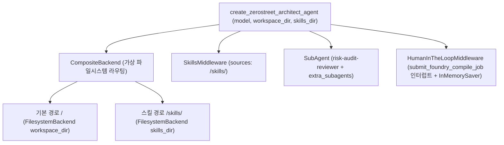

# 내장 5대 에이전트 스킬 및 DeepAgents 아키텍트 구조

`zerostreet-mcp`는 고객 에이전트가 온보딩 단계(Build-Time)에서 따라야 할 **내장 5종 MIT 라이선스 에이전트 스킬**과, 이를 단계적으로 불러와 안전하게 시스템을 설계해 주는 **DeepAgents 기반 빌드타임 아키텍트(`create_zerostreet_architect_agent`)**를 제공합니다.

---

## 1. Progressive Disclosure 5대 에이전트 스킬

모든 스킬은 Anthropic Agent Skills 명세(`SKILL.md` YAML 프론트매터)를 따릅니다. 특정 종목의 매수·매도 추천이나 목표 주가 제시는 엄격히 금지하며, **사실 기반 서술 분석(Descriptive Analytics)**과 **로컬 엔지니어링 스캐폴딩**만 수행하도록 설계되어 있습니다.

| 스킬 이름 | 역할 설명 | 스킬 파일 |
| :--- | :--- | :--- |
| `sovereign-system-architect` | 하이브리드 계층(`alphagraph`, `zerosteer` 백본, `alphasmith` 파운드리) 조립 및 HITL 안전 설계 가이드 | [`SKILL.md`](../../skills/sovereign-system-architect/SKILL.md#L1-L23) |
| `portfolio-risk-audit` | 사후 `RunTrace` 기여도 분해, HHI 집중도, 3시그마 이탈 감사 체크리스트 | [`SKILL.md`](../../skills/portfolio-risk-audit/SKILL.md#L1-L26) |
| `pre-trade-risk-gate` | 결정론적 킬스위치, 회전율 상한, 주문 금액 한도 및 HITL 승인 게이트 규칙 | [`SKILL.md`](../../skills/pre-trade-risk-gate/SKILL.md#L1-L25) |
| `macro-crisis-sim` | `2020_COVID`, `2022_Rate_Shock`, `2024_Yen_Carry` 3대 역사적 위기 스트레스 테스트 절차 | [`SKILL.md`](../../skills/macro-crisis-sim/SKILL.md#L1-L25) |
| `rebalance-math-solver` | 심플렉스 비중 정규화, 매수·매도 수량 차이, 회전율 패널티 계산 수학 규격 | [`SKILL.md`](../../skills/rebalance-math-solver/SKILL.md#L1-L26) |

---

## 2. 스킬 레지스트리 및 규제 자동 검증 (`skill_registry.py`)

[`skill_registry.py`](../../src/zerostreet_mcp/skill_registry.py#L1-L143)는 2단계 점진적 로딩(Progressive Disclosure)과 자동 규제 검사를 처리합니다.

- **1단계 목록 탐색 (`discover_skills`)**: `SKILL.md`의 YAML 프론트매터만 먼저 읽어 정렬된 `SkillCatalogEntry` 목록을 반환하므로 에이전트 컨텍스트를 아낄 수 있습니다.
- **2단계 전체 본문 로드 (`load_skill_markdown`)**: 경로 탈출 문자열(`/`, `\`, `..`)이 포함되면 즉시 차단한 뒤 요청한 스킬의 전체 지침 본문을 불러옵니다.
- **규제 및 무결성 감사 (`validate_skills_compliance`)**: 5대 필수 스킬이 모두 존재하는지, 이름(`64`자 이하)·설명(`1024`자 이하) 길이 제한을 지키는지, 라이선스가 `MIT`인지, 그리고 가중치 바이너리 파일(`.pt`, `.pth`, `.safetensors`, `.onnx`, `.ckpt`)이 0건인지 검사합니다.

---

## 3. DeepAgents 빌드타임 아키텍트 (`architect_agent.py`)

[`create_zerostreet_architect_agent()`](../../src/zerostreet_mcp/architect_agent.py#L1-L205)는 고객 에이전트가 유료 GPU 파운드리를 호출하기 전 사람 승인을 받도록 미들웨어를 조립합니다.

- **명시적 모델 주입 강제**: `model=None`으로 호출하는 것을 거부해 검증된 언어 모델이 명시적으로 전달되도록 강제합니다.
- **유료 컴파일 직전 HITL 일시 정지**: 유료 GPU 컴파일을 요청하는 `submit_foundry_compile_job` 실행 직전에 그래프가 `__interrupt__`로 멈추고, 사용자가 `Command(resume={"decisions": [{"type": "approve"}]})`로 승인해야만 `AlphaSmithFoundryClient.compile_policy()`를 호출합니다.

---

## 관련 문서

- [zerostreet-mcp v0.1.0 개요 및 빠른 시작](../quickstart.md)
- [FastMCP 서버(zerostreet-mcp) 및 로컬 런타임 스캐폴딩 워크플로우](../workflows/foundry-mcp-scaffolding.md)
