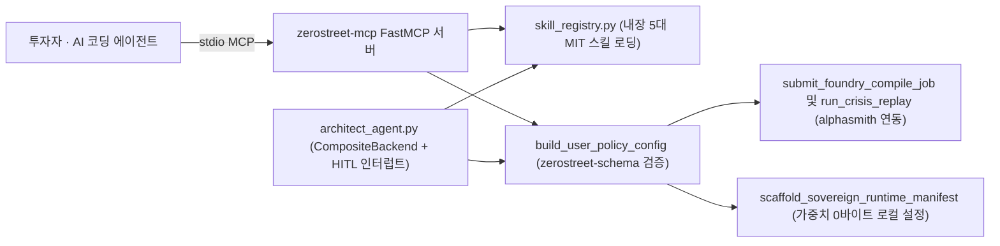

# zerostreet-mcp v0.1.0 개요 및 빠른 시작

## 왜 이 프로젝트가 필요한가요? (비즈니스 역할 및 소비자 가치)

`zerostreet-mcp`(`v0.1.0`, Public MIT)는 주식회사 제로스트리트(ZeroStreet Inc.)의 **Layer 0.5 공식 MCP 서버 및 빌드타임 에이전트 온보딩 패키지**입니다([`__init__.py`](../src/zerostreet_mcp/__init__.py#L1-L41)). 투자자가 Claude Desktop이나 Antigravity 같은 코딩 도우미를 이용해 나만의 자동 투자 시스템을 꾸리려 할 때 흔히 겪는 두 가지 불안을 해소합니다.

1. **AI 코딩 도우미가 리스크 검증 없이 허술한 매매 설정을 만들어 줄까 걱정됩니다.**  
   내장된 5종의 MIT 에이전트 스킬(`SKILL.md`)이 리밸런싱 수학 정합성, 사전 리스크 게이트, 거시 위기 시뮬레이션 체크리스트를 단계별(Progressive Disclosure)로 제공해, 에이전트가 반드시 검증된 안전 규칙을 따르게 합니다.
2. **클라우드 파운드리와 로컬 실행 데몬 설정을 수작업으로 맞추기 번거롭습니다.**  
   **FastMCP**(`fastmcp>=4.0`) 기반의 `zerostreet-mcp` 서버(`name="zerostreet-mcp"`)가 `UserPolicyConfig` 검증, `alphasmith` 위기 리플레이·GPU 파운드리 컴파일 요청, 그리고 회사 가중치가 전혀 섞이지 않은(`contains_company_weights=False`) 로컬 `alphagraph` 청사진 생성까지 6가지 도구로 깔끔히 연결해 줍니다. 물론 이 저장소에도 **회사 자체 매매 가중치는 0바이트**만 유지됩니다([README.md](../README.md#L1-L72)).

---

## FastMCP 서버 · 내장 스킬 · 아키텍트 연결 흐름



---

## 패키지 구성 요소 및 MCP 연동 (`src/zerostreet_mcp/`)

| 구성 요소 | 핵심 기능 | 파일 경로 |
| :--- | :--- | :--- |
| **`pyproject.toml`** | `fastmcp>=4.0.0`, `deepagents`, `langchain-core`, `langgraph`, `zerostreet-schema` 의존성 및 `zerostreet-mcp`(`zerostreet-foundry-mcp` 별칭) 스크립트 정의 | [`pyproject.toml`](../pyproject.toml#L1-L49) |
| **`claude_desktop_config.example.json`** | `uv --directory /path/to/zerostreet-mcp run zerostreet-mcp` 실행과 `ALPHASMITH_BASE_URL` · `ZEROSTREET_API_KEY` 등록 예시 | [`claude_desktop_config.example.json`](../claude_desktop_config.example.json#L1-L17) |
| **`skill_registry.py`** | 내장 5대 `SKILL.md` 점진적 로딩(`discover_skills`, `load_skill_markdown`) 및 규제 검사(`validate_skills_compliance`) | [`skill_registry.py`](../src/zerostreet_mcp/skill_registry.py#L1-L143) |
| **`foundry_mcp.py`** | `FastMCP`(`fastmcp>=4.0`, `name="zerostreet-mcp"`) 6종 도구(`show_banner=False` stdio) 및 `AlphaSmithFoundryClient` | [`foundry_mcp.py`](../src/zerostreet_mcp/foundry_mcp.py#L1-L280) |
| **`architect_agent.py`** | `/skills/` 가상 파일시스템(`CompositeBackend`) 및 유료 컴파일 전 HITL(`HumanInTheLoopMiddleware`) 아키텍트 | [`architect_agent.py`](../src/zerostreet_mcp/architect_agent.py#L1-L205) |

---

## 로컬 설치 및 검증

```bash
uv sync --dev
uv run ruff check .
uv run pytest -v
```

---

## 세부 문서 바로가기

- [내장 5대 에이전트 스킬 및 DeepAgents 아키텍트 구조](./architecture/skills-and-architect-agent.md)
- [FastMCP 서버(zerostreet-mcp) 및 로컬 런타임 스캐폴딩 워크플로우](./workflows/foundry-mcp-scaffolding.md)
- [대문 안내 (한국어)](../README.md) · [English README](../README.en.md)
