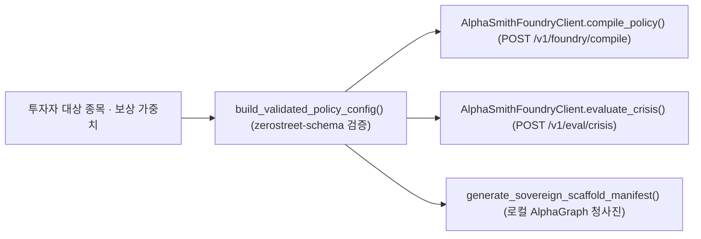

# Foundry MCP 서버 및 로컬 런타임 스캐폴딩 워크플로우

`zerostreet_skills.foundry_mcp`([`foundry_mcp.py`](../../src/zerostreet_skills/foundry_mcp.py#L1-L280))는 외부 코딩 에이전트(Claude Desktop/Code, Codex, Antigravity 등)가 `stdio` MCP 프로토콜로 제로스트리트 5대 스킬을 조회하고, 사용자 투자 정책을 검증한 뒤 `alphasmith` GPU 정책 헤드 컴파일·위기 평가·로컬 `alphagraph` 청사진 생성까지 자동 처리할 수 있게 연결합니다.

---

## 1. `FastMCP` (`fastmcp>=4.0`) 통합 및 실행 엔트리포인트

- **독립형 `FastMCP` 프레임워크 적용**: `from fastmcp import FastMCP`를 사용해 `mcp_server = FastMCP(name="zerostreet-foundry", ...)` 인스턴스를 구성하며, `zerostreet_skills/__init__.py`의 `mcp_server` 공개 심볼을 그대로 유지합니다.
- **CLI 실행 엔트리포인트**: [`pyproject.toml`](../../pyproject.toml#L30-L32)이 `zerostreet-foundry-mcp` 명령을 노출하며, 실행 시 `main()`이 `mcp_server.run(transport="stdio", show_banner=False)`로 깔끔한 `stdio` 전송 채널을 엽니다(Claude Desktop·Cursor·Antigravity와 충돌 없이 JSON-RPC 프레임만 송수신).

---

## 2. 공개된 6종 `FastMCP` 도구

`@mcp_server.tool()` 데코레이터로 등록된 6가지 도구는 모두 스키마 불변식과 비투자자문 원칙을 강제합니다.

| 도구 이름 | 동작 및 위임 대상 | 안전장치 |
| :--- | :--- | :--- |
| `list_zerostreet_skills` | `discover_skills()`로 1단계 스킬 메타데이터 목록 조회 | 요약 정보만 먼저 노출해 컨텍스트 절약 |
| `read_zerostreet_skill` | `load_skill_markdown()`으로 선택한 `SKILL.md` 전체 본문 로드 | 경로 탈출 문자 즉시 차단 |
| `build_user_policy_config` | `build_validated_policy_config()`로 `UserPolicyConfig` 검증·직렬화 | 양수 목적함수 및 최소 2개 고유 종목 강제 |
| `submit_foundry_compile_job` | `AlphaSmithFoundryClient.compile_policy()`로 컴파일 요청 전송 | Bearer 토큰 인증 및 티어 검사 |
| `run_crisis_replay` | `AlphaSmithFoundryClient.evaluate_crisis()`로 역사적 위기 리플레이 실행 | 과거 위기 수치 시뮬레이션 전용 |
| `scaffold_sovereign_runtime_manifest` | `generate_sovereign_scaffold_manifest()`로 로컬 실행 청사진 생성 | `contains_company_weights: False` 0바이트 고정 |

---

## 3. 정책 검증 · 컴파일 · 스캐폴딩 흐름 및 인메모리 검증

- **`AlphaSmithFoundryClient` 및 `fastmcp.Client` 검증**: `AlphaSmithFoundryClient`는 `ALPHASMITH_BASE_URL`(기본 `http://127.0.0.1:8000`)과 `ZEROSTREET_API_KEY` 환경변수를 읽어 `Authorization: Bearer <api_key>` 헤더로 요청합니다. [`test_skills_and_mcp.py`](../../tests/test_skills_and_mcp.py#L100-L199)는 `isinstance(mcp_server, FastMCP)` 확인, `fastmcp.Client(mcp_server)` 인메모리 `list_tools()` / `call_tool()` 종단간 호출, 그리고 `httpx.MockTransport` 기반 오프라인 HTTP 테스트를 모두 검증합니다.
- **스캐폴드 매니페스트 (`generate_sovereign_scaffold_manifest`)** ([`foundry_mcp.py`](../../src/zerostreet_skills/foundry_mcp.py#L110-L150)): `compliance_mode: "Non-Advisory-Info-Provider-And-SW-Rental"`, `contains_company_weights: False`, 로컬 SQLite 체크포인트 경로(`sqlite://./.alphagraph_state.db`), 방화벽 한도, 그리고 실제 비밀값 대신 필요한 환경변수 키 이름 목록만 담아 돌려줍니다.

---

## 관련 문서

- [zerostreet-skills v0.1.0 개요 및 빠른 시작](../quickstart.md)
- [5대 에이전트 스킬 및 DeepAgents 아키텍트 구조](../architecture/skills-and-architect-agent.md)
