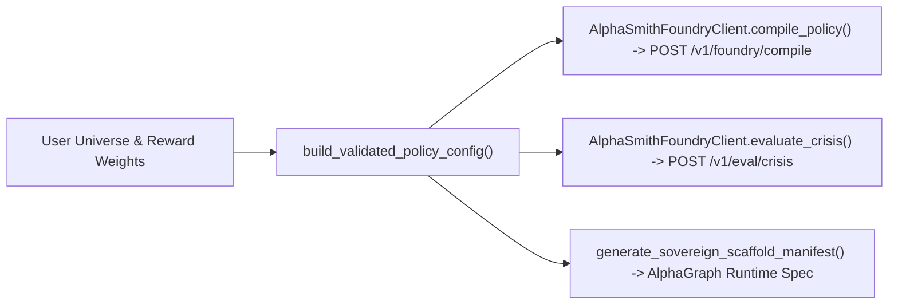

# Foundry MCP Server & Sovereign Scaffolding Workflow / Foundry MCP 서버 및 Sovereign 스캐폴딩 워크플로우

`zerostreet_skills.foundry_mcp` ([`foundry_mcp.py`](../../src/zerostreet_skills/foundry_mcp.py)) enables external coding agents (Claude Desktop/Code, Codex, Antigravity) to browse ZeroStreet's 5 skills over `stdio` MCP, validate user policy specifications, invoke `AlphaSmith` GPU Policy Head compilation, and scaffold local `AlphaGraph` runtimes.

`zerostreet_skills.foundry_mcp`는 외부 코딩 에이전트(Claude Desktop/Code, Codex, Antigravity 등)가 `stdio` MCP 프로토콜을 통해 ZeroStreet 5대 스킬을 조회하고, `AlphaSmith` 컨트롤 플레인에서 사용자 전용 Policy Head를 컴파일하거나 로컬 `AlphaGraph` 런타임 설정을 조립할 수 있도록 돕습니다.

---

## 1. `mcp>=2.0` `MCPServer` Integration & Entrypoint / `MCPServer` 통합 및 엔트리포인트

* **SDK Compatibility / SDK 호환성**: Uses `from mcp.server.mcpserver import MCPServer` (`mcp==2.3.0`, where legacy `FastMCP` was removed) instantiated as `mcp_server = MCPServer(name="zerostreet-foundry", ...)`. (`mcp==2.3.0`에서 제거된 레거시 `FastMCP` 대신 `MCPServer`를 사용합니다.)
* **CLI Script / 실행 엔트리포인트**: `pyproject.toml` exposes `zerostreet-foundry-mcp`, invoking `main()` with `mcp_server.run(transport="stdio")`. (`zerostreet-foundry-mcp` 스크립트가 `stdio` 전송으로 서버를 기동합니다.)

---

## 2. Exposed MCP Tools (6 Tools) / 공개 MCP 툴 (6종)

Registered via `@mcp_server.tool()` with strict schema and non-advisory guardrails:

`@mcp_server.tool()` 데코레이터로 등록된 6개 도구는 다음과 같습니다.

| Tool / 툴 이름 | Behavior & Delegation / 기능 및 위임 대상 | Guardrail / 안전 장치 |
| :--- | :--- | :--- |
| `list_zerostreet_skills` | Lists Level 1 metadata via `discover_skills()` / Level 1 스킬 메타데이터 반환 | Progressive summary only / 요약 메타데이터만 노출 |
| `read_zerostreet_skill` | Loads full `SKILL.md` via `load_skill_markdown()` / 요청 스킬 전체 본문 로드 | Rejects path traversal / 경로 탈출 문자 차단 |
| `build_user_policy_config` | Validates `UserPolicyConfig` via `build_validated_policy_config()` / 정책 스키마 검증 | Requires positive objective weights / 양수 목적함수 필수 |
| `submit_foundry_compile_job` | Dispatches `PolicyCompileRequest` via `AlphaSmithFoundryClient.compile_policy()` / Foundry 컴파일 실행 | Bearer auth & tier check / 토큰 인증 및 티어 검증 |
| `run_crisis_replay` | Calls `AlphaSmithFoundryClient.evaluate_crisis()` / 3대 위기 스트레스 리플레이 | Descriptive analytics only / 역사적 수치 평가 전용 |
| `scaffold_sovereign_runtime_manifest` | Outputs manifest via `generate_sovereign_scaffold_manifest()` / 로컬 실행 매니페스트 생성 | Fixed `contains_company_weights: False` / 가중치 0바이트 고정 |

---

## 3. Policy Validation, Compilation & Scaffolding Flow / 정책 검증·컴파일·스캐폴드 흐름

* **`AlphaSmithFoundryClient`**: Reads `ALPHASMITH_BASE_URL` (default `http://127.0.0.1:8000`) and `ZEROSTREET_API_KEY`, sending `Authorization: Bearer <api_key>` requests with injectable `httpx.MockTransport` support verified in [`test_skills_and_mcp.py`](../../tests/test_skills_and_mcp.py). (환경변수를 읽어 Bearer 인증 HTTP 요청을 보내며 `MockTransport` 기반 오프라인 테스트를 지원합니다.)
* **Scaffold Manifest (`generate_sovereign_scaffold_manifest`) / 스캐폴드 매니페스트**: Emits `compliance_mode: "Non-Advisory-Info-Provider-And-SW-Rental"`, `contains_company_weights: False`, local SQLite checkpointing (`sqlite://./.alphagraph_state.db`), guardrail limits, and required env key names without secrets. (비투자자문 모드, 가중치 미포함, 로컬 SQLite 체크포인트 및 가드레일 구성을 반환합니다.)

## Related Documentation / 관련 문서

* [Agent Skills & DeepAgents Architect Architecture / 5대 스킬 및 Architect 구조](../architecture/skills-and-architect-agent.md)
* [zerostreet-skills Quickstart & Business Overview / 빠른 시작 및 비즈니스 개요](../quickstart.md)
